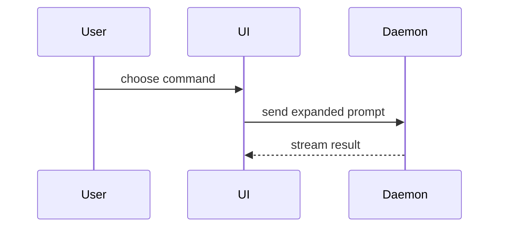

Pick **smallest view** that makes key point clear. Keep prose brief.

- Logic or algorithm → pseudocode:

```text
on(save)
  if content is unchanged
    return cached result
  write new content
  return fresh result
```

- Runtime control flow → call tree:

```text
submitForm
  createSession
    persistPrompt
    launchAgent
  navigateToSession
```

- UI structure → component tree, with state and module boundaries that matter:

```tsx
<SessionPage> (apps/example/src/routes/session.tsx)
  useSessionEvents()
  <SessionToolbar>
    <RunSkillButton> (packages/ui)
```

- File responsibility or broad refactor → shallow file tree:

```text
src/
├── commands/       # parses user actions
├── sessions/       # owns session state
└── transport/      # sends API requests
```

- Messages between two+ participants (user, UI, service) → Mermaid. Single call path in one process = call tree, not diagram:



Mermaid renders on GitHub and HTML, not terminal reply. In terminal, draw same diagram as `text` fence.

- Use `diff` over any view above when point is what changes and surrounding shape already exists. Keep unchanged lines as context so ownership and order stay visible:

```diff
 submitForm
   createSession
     persistPrompt
+    expandSkillMention
     launchAgent
   navigateToSession
+    subscribeToEvents
```

```diff
 src/
 ├── commands/
+│   └── show-me.ts       # expands the slash command
 ├── sessions/
-└── transport.ts
+└── transport/
+    ├── client.ts
+    └── stream.ts
```

- Show whole block when most is new, when omitted context hides ownership or order, or when user needs copyable target shape:

```ts
function expandSkill(command: string): string {
  const skillName = command.slice(1);
  return `use the ${skillName} skill`;
}
```

- Visual UI, layout, state comparison, or concept too dense for Mermaid → write one focused HTML file in session scratch dir, or system temp dir if none: diagram, infographic, or short slide deck, whichever fits. Match product colors, type, spacing, components; use real labels and data; support desktop and mobile. Then open it: `start <file>` on Windows, `open <file>` on macOS, `xdg-open <file>` on Linux.

Place each visual next to short text it supports. Keep only calls, files, props, states, boundaries current question needs. Done when every visual answers current question and every element in it is needed.

## In a pull request

Reviewer sees files one at a time; PR description shows how they fit. Read branch diff (`git diff <base>...HEAD`), then add visual under summary line for each structural change file list hides: new call path, moved module boundary, new component, new message between services. Label each node with name of component, module or step existing in diff. Omit string literals, regexes, flags, numbers from code. `diff` of before shape usually smallest view.

GitHub renders `mermaid` and `diff` fences in PR body. HTML file can't live there — Markdown views only.

Change with no structural shift (one-file fix, rename, dependency bump) gets no visual.

Done when every structural change in diff has visual or is self-evident from file list, and every name in every visual exists in diff.
